# ออเดอร์ไว · ระบบขายหน้าร้านและสั่งผ่าน QR สำหรับร้านอาหารและร้านค้าหลายประเภท

ลูกค้าสแกน QR ที่โต๊ะแล้วสั่งอาหารจากมือถือได้ทันที ไม่ต้องลงแอป ไม่ต้องสมัครสมาชิก
ออเดอร์ขึ้นจอครัวภายในเสี้ยววินาที หลังร้านออกบิล PromptPay คิดเงินทอน จัดการเมนู ดูยอดขาย และสำรองข้อมูลได้ในที่เดียว
**ไม่ใช่แค่ร้านอาหาร:** เลือกประเภทธุรกิจได้ 14 แบบ ร้านกาแฟ ชานมไข่มุก เบเกอรี่ ค้าปลีก ขายส่ง ของสด อุปกรณ์ก่อสร้าง เสริมสวย เครื่องเขียน เสื้อผ้า ขายยา ขายออนไลน์ และร้านรับซื้อของ
มีหน้า **ขายหน้าร้าน** สแกนบาร์โค้ด ขายตามน้ำหนัก ราคาส่ง ส่งคิวเข้าบาร์ และรับซื้อของ ([ดูหัวข้อนี้](#ใช้ได้กับธุรกิจหลายประเภท))
**สต็อกและเอกสาร:** ตัดสต็อกเมื่อขาย รับเข้า เบิกออก ตรวจนับ บัตรสต็อก และออก **ใบเสนอราคา ใบส่งของ/ใบแจ้งหนี้ ใบเสร็จ A4 ใบสั่งซื้อ** พิมพ์หรือบันทึกเป็น PDF ได้ ([ดูหัวข้อนี้](#เอกสารและสต็อก))
ทั้งระบบรันบนคอมพิวเตอร์เครื่องเดียวในร้าน ใช้แค่ WiFi ภายใน **ทำงานได้แม้อินเทอร์เน็ตล่ม**

<p align="center">
  
  
  
</p>
<p align="center">
  
</p>

| | |
|---|---|
| **ใช้กับ** | ร้านอาหารนั่งทาน ขนาดเล็กถึงกลาง (ไม่เกิน 60 โต๊ะ) และร้านค้าหน้าร้าน 14 ประเภท (ร้านเดียว) |
| **ต้องมี** | คอมพิวเตอร์ 1 เครื่อง (Windows / macOS / Linux) + Node.js 18 ขึ้นไป + เราเตอร์ WiFi |
| **ไม่ต้องมี** | ฐานข้อมูล, `npm install`, อินเทอร์เน็ต, ค่าบริการรายเดือน |
| **ภาษา** | ไทยทั้งระบบ รองรับโหมดสว่าง/มืด มือถือ แท็บเล็ต และคอมพิวเตอร์ |
| **คุณภาพ** | ชุดทดสอบอัตโนมัติ 112 เคส + ทดสอบบนเบราว์เซอร์จริง 290 ข้อ + ตรวจการเข้าถึงตามมาตรฐาน WCAG 2.2 AA |

---

## สารบัญ

1. [ภาพรวมการทำงาน](#ภาพรวมการทำงาน) · **[ใช้ได้กับธุรกิจหลายประเภท (ขายหน้าร้าน)](#ใช้ได้กับธุรกิจหลายประเภท)** · **[เอกสารและสต็อก](#เอกสารและสต็อก)**
2. [ส่วนต่างๆ ของระบบ (พร้อมภาพหน้าจอ)](#ส่วนต่างๆ-ของระบบ)
   - [หน้าลูกค้า](#1-หน้าลูกค้า-สแกน-qr-ที่โต๊ะ)
   - [หน้าพนักงาน](#2-หน้าพนักงาน-staff)
3. [ติดตั้งและเริ่มใช้งาน](#ติดตั้งและเริ่มใช้งาน)
4. [คู่มือการใช้งานรายวัน](#คู่มือการใช้งานรายวัน) · **[คู่มือการใช้งานทีละขั้น แยกตามหน้าที่ (docs/GUIDE.md)](docs/GUIDE.md)**
5. [รีวิวระบบ: ข้อดี ข้อจำกัด และคำแนะนำ](#รีวิวระบบ)
6. [ความปลอดภัยและความน่าเชื่อถือของข้อมูล](#ความปลอดภัยและความน่าเชื่อถือของข้อมูล)
7. [แก้ปัญหาที่พบบ่อย](#แก้ปัญหาที่พบบ่อย)
8. [สำหรับนักพัฒนา](#สำหรับนักพัฒนา)

---

## ภาพรวมการทำงาน

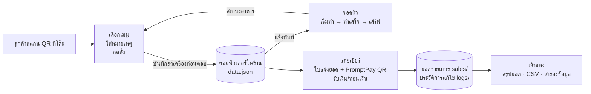

1. **ลูกค้า** สแกน QR บนโต๊ะ ระบบรู้เลขโต๊ะเอง เลือกอาหาร ใส่หมายเหตุ (ไม่เผ็ด ไม่ใส่ผัก) แล้วกดสั่ง
2. **ครัว** เห็นออเดอร์ใหม่พร้อมเสียงเตือน กด "เริ่มทำ" → "ทำเสร็จ" ลูกค้าเห็นสถานะเปลี่ยนบนมือถือ
3. **พนักงานหน้าร้าน** เห็นโต๊ะที่อาหารพร้อมเสิร์ฟหรือขอเช็คบิล เปิดใบแจ้งยอดที่มี QR PromptPay ตามยอดจริง
4. **แคชเชียร์** รับเงินสด (ระบบคำนวณเงินทอน) หรือรับโอน แล้วพิมพ์ใบเสร็จ 80 มม.
5. **เจ้าของ** ดูยอดขายวันนี้ เงินสด/โอน เมนูขายดี ประวัติการแก้ไข และดาวน์โหลดยอดเป็น CSV ส่งบัญชี

---

## ใช้ได้กับธุรกิจหลายประเภท

เจ้าของเลือกที่ **ตั้งค่า > ประเภทธุรกิจ** (ร้านที่ใช้อยู่แล้วยังทำงานแบบร้านอาหารเหมือนเดิมจนกว่าจะเลือก) ระบบจะปรับ
คำที่ใช้ในหน้าจอ (เมนู / สินค้า / บริการ, ครัว / บาร์) วิธีขายที่เปิด และค่าบริการเริ่มต้นให้ทันที เลือกแล้วเปลี่ยนใหม่ได้ตลอด
จะให้แทนที่เมนูด้วยสินค้าตัวอย่างของประเภทนั้นก็ได้ (ระบบสำรองของเดิมไว้ให้ก่อนเสมอ)

<p align="center">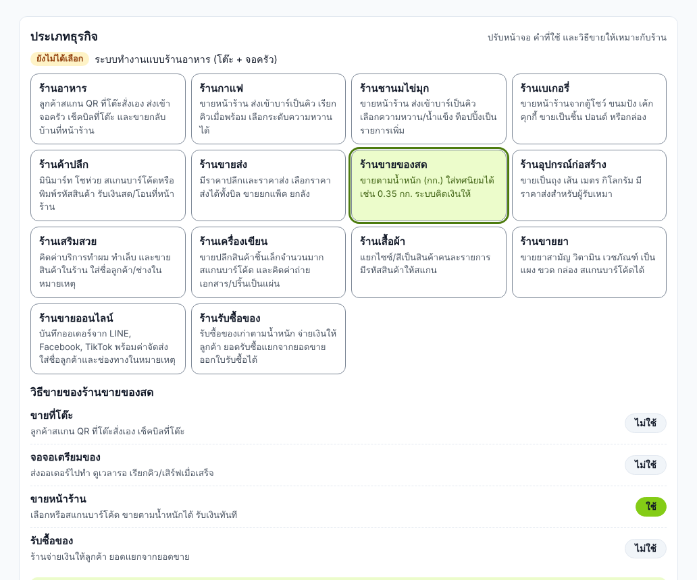</p>

| ประเภท | วิธีขายเริ่มต้น | ใช้อะไรเป็นหลัก |
|---|---|---|
| ร้านอาหาร | โต๊ะ + QR, จอครัว, ขายหน้าร้าน | ลูกค้าสั่งเองที่โต๊ะ เช็คบิลที่โต๊ะ ขายกลับบ้านที่หน้าร้าน |
| ร้านกาแฟ, ร้านชานมไข่มุก | ขายหน้าร้าน + จอบาร์ | สั่งที่เคาน์เตอร์ จ่ายก่อน ได้เลขคิว บาร์ทำเสร็จแล้วเรียกคิว เลือกความหวาน/น้ำแข็งเป็นหมายเหตุ ท็อปปิ้งเป็นรายการเพิ่ม |
| ร้านเบเกอรี่ | ขายหน้าร้าน | ขายจากตู้โชว์ เป็นชิ้น ปอนด์ หรือก้อน |
| ร้านค้าปลีก, ร้านเครื่องเขียน, ร้านเสื้อผ้า, ร้านขายยา | ขายหน้าร้าน + สต็อก + เอกสาร | สแกนบาร์โค้ด/พิมพ์รหัสสินค้า ไซซ์/สีแยกเป็นรหัสคนละตัว ตัดสต็อกทุกครั้งที่ขาย |
| ร้านขายส่ง, ร้านอุปกรณ์ก่อสร้าง | ขายหน้าร้าน + สต็อก + เอกสาร | ราคาปลีกและ **ราคาส่ง** เลือกราคาส่งได้ทั้งบิล ขายเป็นเมตร/คิวเป็นทศนิยมได้ ใบเสนอราคา ใบส่งของ/ใบแจ้งหนี้ (เครดิต) ใบสั่งซื้อ |
| ร้านขายของสด | ขายหน้าร้าน | ขาย **ตามน้ำหนัก** ใส่ 0.35 กก. แล้วระบบคิดเงินให้ |
| ร้านเสริมสวย | ขายหน้าร้าน | คิดค่าบริการ + ขายสินค้า ใส่ชื่อลูกค้า/ช่างในหมายเหตุ |
| ร้านขายออนไลน์ | ขายหน้าร้าน + สต็อก + เอกสาร | บันทึกออเดอร์จากแชท พร้อมรายการค่าจัดส่ง ใส่ชื่อลูกค้าและช่องทางในหมายเหตุ ส่งใบแจ้งหนี้ PDF ให้ลูกค้าโอน |
| ร้านรับซื้อของ | ขายหน้าร้าน + **รับซื้อ** + สต็อก + เอกสาร | ชั่งน้ำหนัก จ่ายเงินให้ลูกค้า ออกใบรับซื้อ ยอดรับซื้อแยกจากยอดขายเสมอ ของที่รับซื้อเข้าสต็อก ขายต่อให้โรงงานด้วยใบส่งของ/ใบแจ้งหนี้ |

วิธีขายเปิด/ปิดแยกกันได้: **ขายที่โต๊ะ** (QR ให้ลูกค้าสั่งเอง) · **จอครัว/บาร์** (ส่งออเดอร์ไปทำ) · **ขายหน้าร้าน** · **รับซื้อของ** · **สต็อกสินค้า** · **เอกสารธุรกิจ** (ร้านอาหารเปิดเพิ่มได้ เช่น ออกใบเสนอราคางานจัดเลี้ยง)
ร้านที่ไม่ใช้โต๊ะจะไม่เห็นแท็บโต๊ะ ช่องจำนวนโต๊ะ และ QR ติดโต๊ะ (ค่าเดิมยังอยู่ เปิดกลับมาก็ใช้ต่อได้)

### หน้าขายหน้าร้าน

<p align="center">
  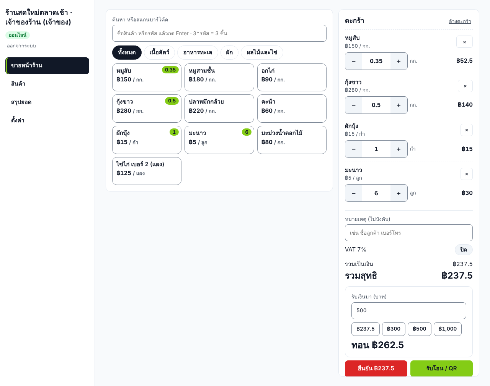
  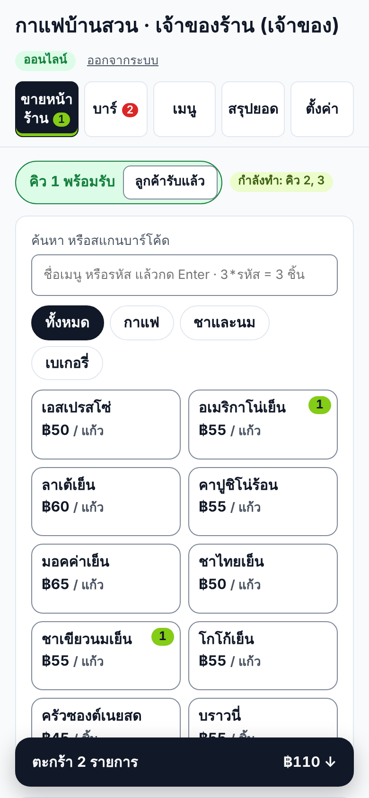
</p>

1. **เพิ่มของลงตะกร้า:** แตะสินค้า หรือ **สแกนบาร์โค้ด** (เครื่องสแกนแบบ USB/บลูทูธที่พิมพ์เหมือนคีย์บอร์ดใช้ได้เลย) หรือพิมพ์ชื่อ/รหัสแล้วกด Enter · พิมพ์ `3*รหัส` = 3 ชิ้น
2. **ของชั่งน้ำหนัก:** สินค้าที่ตั้ง "ขายเป็นทศนิยม" แตะแล้วพิมพ์น้ำหนักได้ทันที เช่น 0.35 (กก.) ระบบคิดเงินให้ถึงสตางค์
3. **ตัวเลือก:** ราคาปลีก/ราคาส่ง (เมื่อมีสินค้าที่ตั้งราคาส่ง) · ส่งเข้าครัว/บาร์ (ได้เลขคิว) · หมายเหตุต่อรายการ (เช่น หวานน้อย) · หมายเหตุของบิล (ชื่อลูกค้า เบอร์โทร) · VAT
4. **รับเงิน:** กด "รับเงินสด" แล้วใส่เงินที่รับมา ระบบบอกเงินทอน หรือกด "รับโอน / QR" ให้ลูกค้าสแกน QR พร้อมเพย์ที่มียอดอยู่แล้ว แล้วกด **ยืนยัน** อีกครั้ง (กันกดพลาด)
5. **ใบเสร็จ:** พิมพ์ได้ทันที (80 มม.) เลขที่ใบเสร็จต่อจากบิลโต๊ะ ยอดเข้าสรุปยอดและ CSV เหมือนบิลโต๊ะ

ตะกร้าอยู่ในเครื่องนั้น รีเฟรชหน้าแล้วไม่หาย · ถ้าราคาสินค้าถูกแก้จากอีกเครื่องระหว่างกดรับเงิน ระบบไม่ขายด้วยราคาใหม่เงียบๆ แต่ให้ตรวจยอดใหม่ก่อน · กดยืนยันซ้ำหรือเน็ตสะดุดแล้วกดใหม่ ไม่ขายซ้ำ

<p align="center">
  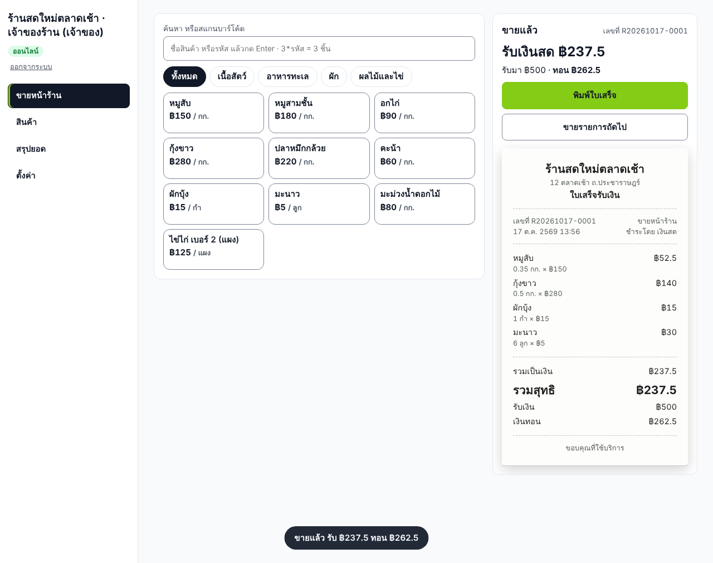
  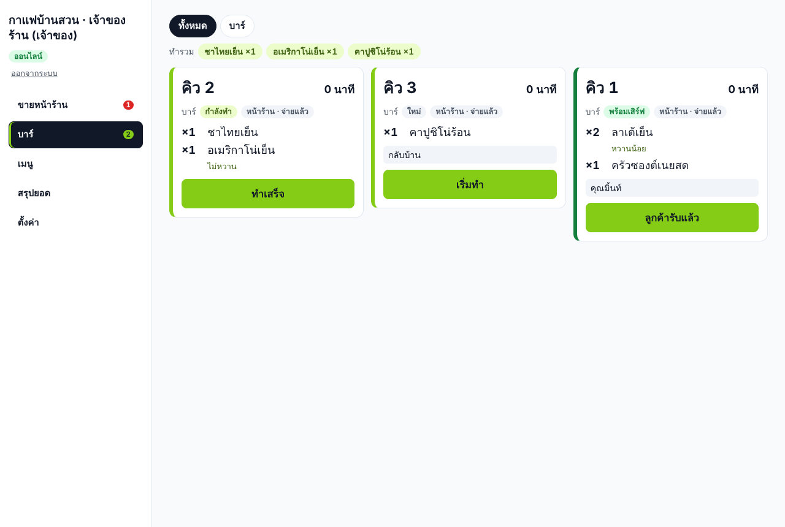
</p>

**ร้านกาแฟ/ชานม (คิว):** ขายแล้วได้เลขคิว ออเดอร์ขึ้นจอบาร์ทันที บาร์กด "เริ่มทำ" → "ทำเสร็จ" หน้าร้านเห็นป้าย "คิว 12 พร้อมรับ" (มีเสียง) เรียกลูกค้าแล้วกด "ลูกค้ารับแล้ว" · คิวเริ่มที่ 1 ใหม่ทุกวัน · คิวจ่ายเงินแล้ว จึงยกเลิกจากจอไม่ได้

**ร้านรับซื้อของ:** หน้าขายเริ่มที่ "รับซื้อ" ใส่น้ำหนัก กด "จ่ายเงินสด" หรือ "โอนให้ผู้ขาย" ได้ใบรับซื้อ สรุปยอดแยก "รับซื้อวันนี้" ออกจากยอดขาย และบอกว่าเงินสดในลิ้นชักควรเปลี่ยนเท่าไร (ขายเงินสด − จ่ายรับซื้อ) CSV มีคอลัมน์ "ประเภท" ขาย/รับซื้อ

**ตั้งค่าสินค้าสำหรับขายหน้าร้าน** (แท็บเมนู/สินค้า > แก้ไข): หน่วย (ชิ้น แก้ว กก. ...) · รหัสสินค้า/บาร์โค้ด (สแกนใส่ช่องได้ ห้ามซ้ำ) · ราคาส่ง · ขายเป็นทศนิยม · "ซ่อน" = เลิกขายชั่วคราว · "ตั้งเป็นหมด" = ของหมด

**ยังไม่มี** (กำลังจะทำต่อ): ตัวเลือกเสริมที่มีราคา (+ไข่มุก) และไซซ์ในสินค้าเดียว ส่วนลดที่หน้าขาย สมาชิก/แต้ม เปิด/ปิดกะ นัดหมายร้านเสริมสวย ล็อตและวันหมดอายุยา สถานะจัดส่งออนไลน์ ต่อเครื่องชั่งอัตโนมัติ (ขายเชื่อใช้ใบส่งของ/ใบแจ้งหนี้ในแท็บเอกสาร)

---

## เอกสารและสต็อก

เปิดได้ที่ **ตั้งค่า > ประเภทธุรกิจ > วิธีขาย** ("สต็อกสินค้า" และ "เอกสารธุรกิจ") ร้านค้าปลีก ขายส่ง อุปกรณ์ก่อสร้าง เครื่องเขียน เสื้อผ้า ขายยา ขายออนไลน์ และรับซื้อของ เปิดให้แล้วเมื่อเลือกประเภทนั้น
ร้านที่ใช้อยู่แล้วไม่มีอะไรเปลี่ยนจนกว่าจะเปิดเอง

<p align="center">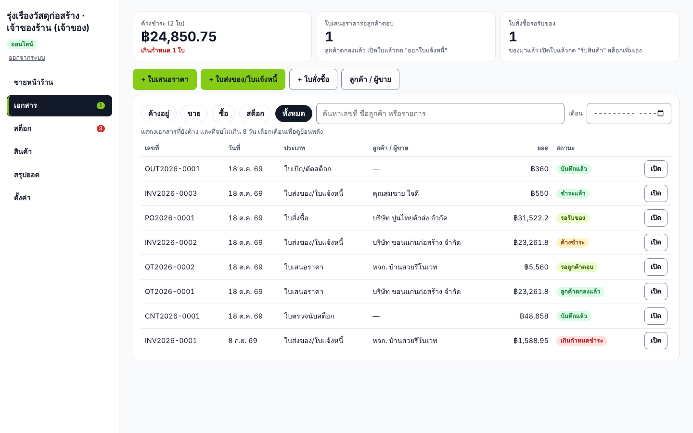</p>

### เอกสาร

| เอกสาร | ใช้เมื่อ | เกิดอะไรขึ้น |
|---|---|---|
| **ใบเสนอราคา** | ลูกค้าขอราคา | ยืนราคาตามวันที่ตั้ง แก้ได้จนกว่าลูกค้าตกลง กด **"ลูกค้าตกลง → ออกใบแจ้งหนี้"** ได้เลย ไม่ต้องพิมพ์ใหม่ |
| **ใบส่งของ/ใบแจ้งหนี้** | ส่งของ (ขายเชื่อ ให้เครดิต) | ตัดสต็อกทันที มีกำหนดชำระ (เครดิตเริ่มต้นตั้งได้) QR PromptPay พร้อมยอดบนเอกสาร พิมพ์แบบ "ใบส่งของ" (ไม่มีราคา) ให้คนขับได้ ร้านที่จด VAT หัวเอกสารเป็น **ใบส่งของ/ใบแจ้งหนี้/ใบกำกับภาษี** |
| **ใบเสร็จรับเงิน (A4)** | ลูกค้าจ่ายตามใบแจ้งหนี้ | กด **"รับชำระ"** (เงินสด/โอน) แล้วยืนยันอีกครั้ง ยอดเข้าสรุปยอดวันนั้นและ CSV เลขที่ใบเสร็จต่อจากบิลหน้าร้าน |
| **ใบสั่งซื้อ** (เจ้าของ) | สั่งของจากผู้ขาย | ของมาแล้วกด **"รับสินค้าตามใบนี้"** ใส่จำนวนที่ได้จริง (ได้ไม่ครบใส่ตามจริง) และราคาตามบิล สต็อกเพิ่ม ต้นทุนเปลี่ยนเอง ได้ **ใบรับสินค้า** |

<p align="center">
  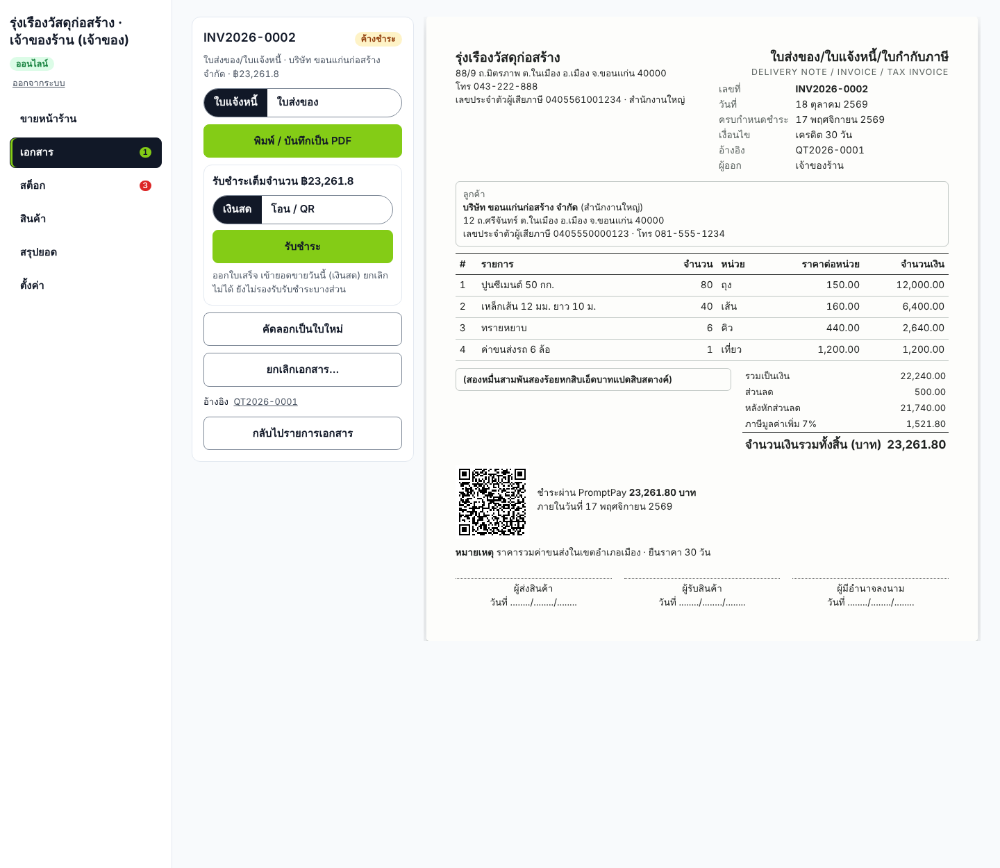
  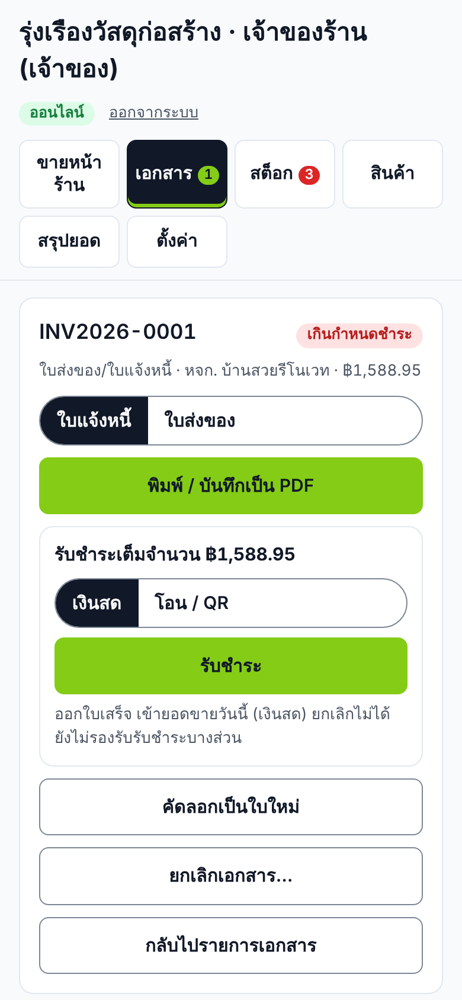
</p>

1. **ออกเอกสาร:** แท็บ **เอกสาร** > "+ ใบเสนอราคา" หรือ "+ ใบส่งของ/ใบแจ้งหนี้" พิมพ์ชื่อลูกค้า (ลูกค้าเดิมเลือกจากรายชื่อ ที่อยู่ เลขผู้เสียภาษี สาขา มาเอง) แล้วใส่รายการ: พิมพ์ชื่อสินค้าหรือ **สแกนบาร์โค้ด** ราคาและหน่วยมาเอง แก้ราคาได้ (ต่อรองราคา) หรือพิมพ์รายการเอง เช่น "ค่าขนส่ง" (ไม่ตัดสต็อก)
2. **ส่วนลดและ VAT:** ส่วนลดท้ายบิลเป็นบาท · VAT 7% คิดเพิ่มจากราคา ยอดรวมและ **จำนวนเงินเป็นตัวหนังสือ** (เช่น "สองหมื่นสามพันสองร้อยหกสิบเอ็ดบาทแปดสิบสตางค์") คิดให้ทันที
3. **พิมพ์ / ส่งให้ลูกค้า:** กด "พิมพ์ / บันทึกเป็น PDF" ได้กระดาษ A4 มีโลโก้ ที่อยู่ เลขผู้เสียภาษีของร้าน ช่องลงชื่อ ชื่อไฟล์ PDF เป็นเลขที่เอกสาร ส่งทาง LINE/อีเมลได้เลย
4. **เลขที่เอกสาร** รันต่อแต่ละประเภทแต่ละปี เช่น QT2026-0001, INV2026-0001 ไม่ซ้ำ ไม่ย้อน แม้ยกเลิกหรือกู้คืนข้อมูล
5. **ยกเลิก** (เจ้าของ): ต้องใส่เหตุผล และยืนยันอีกครั้ง ใบแจ้งหนี้ที่ยกเลิกคืนสต็อกให้เอง ถ้าต้องการออกใหม่ กด "คัดลอกเป็นใบใหม่" · ใบแจ้งหนี้ที่ออกแล้วแก้ไม่ได้ (ส่งของไปแล้ว) ใบที่รับชำระแล้วยกเลิกไม่ได้
6. **ลูกหนี้:** หน้าเอกสารและหน้าสรุปยอดบอกยอดค้างชำระ และใบที่ **เกินกำหนด** (แท็บเอกสารมีตัวเลขแดง) · ดูย้อนหลังทั้งเดือนได้ด้วยช่อง "เดือน" · ค้นหาด้วยเลขที่ ชื่อลูกค้า หรือชื่อสินค้า
7. **ตั้งค่าเอกสาร** (ตั้งค่า > ข้อมูลร้าน): สาขาของร้าน เครดิตเริ่มต้น จำนวนวันยืนราคา และหมายเหตุตั้งต้น (เช่น เลขบัญชีธนาคาร)

<p align="center">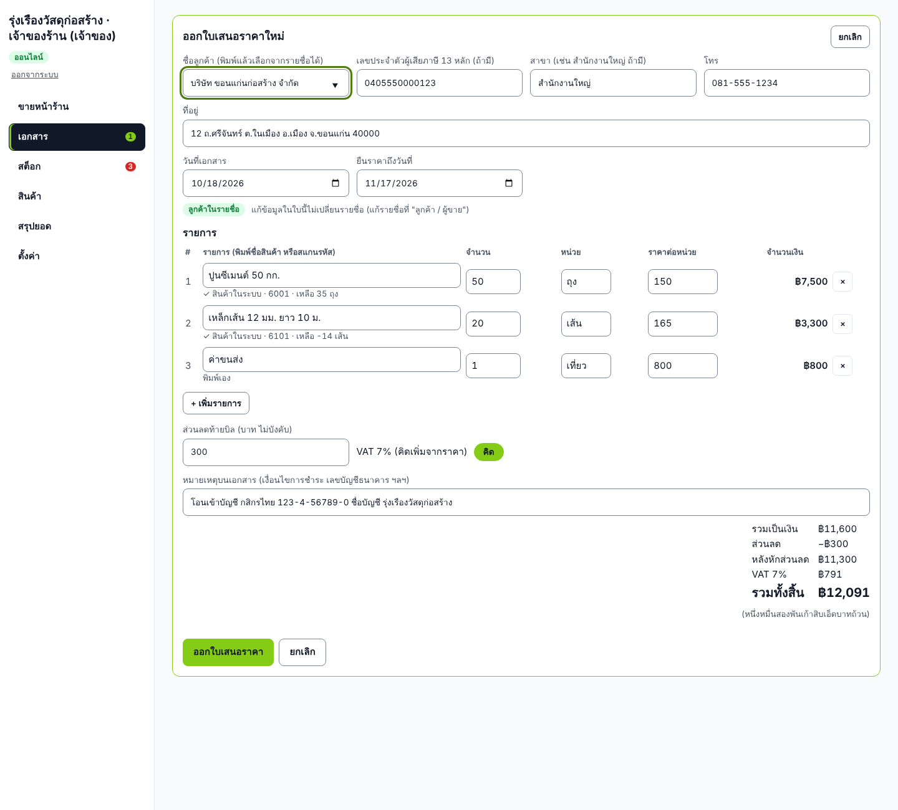</p>

แคชเชียร์ออกใบเสนอราคา/ใบแจ้งหนี้และรับชำระได้ แต่ออกใบสั่งซื้อ ยกเลิกเอกสาร และปรับสต็อกไม่ได้ ทุกการทำรายการมีชื่อคนทำในประวัติการแก้ไข

### สต็อก

<p align="center">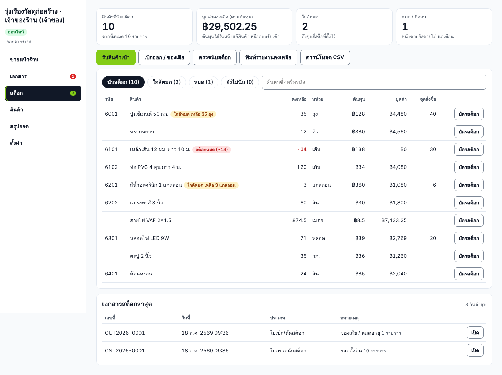</p>

- **เริ่มนับสต็อก:** แท็บ **สต็อก** > "ตรวจนับสต็อก" สแกนหรือพิมพ์ชื่อสินค้า ใส่จำนวนที่มีจริง กด Enter ไปสินค้าถัดไป แล้วบันทึก หรือเปิด "นับสต็อก" และใส่ "ยอดตั้งต้น" ในหน้าแก้สินค้า · รับสินค้าตามใบสั่งซื้อก็เริ่มนับให้เอง
- **ตัดสต็อกอัตโนมัติ:** ขายหน้าร้าน ปิดบิลโต๊ะ และออกใบแจ้งหนี้ · **เพิ่มอัตโนมัติ:** รับซื้อ และรับสินค้าตามใบสั่งซื้อ · ยกเลิกใบแจ้งหนี้คืนสต็อก
- **รับเข้า / เบิกออก / ตรวจนับ** (เจ้าของ): ทุกครั้งได้เอกสาร (ใบรับสินค้า ใบเบิก ใบตรวจนับ) พิมพ์ได้ เบิกออกต้องใส่เหตุผล (ของเสีย ใช้ในร้าน ของหาย ...) ตรวจนับบันทึกส่วนต่างเป็นมูลค่า
- **นับระหว่างร้านยังขายอยู่ได้:** ถ้าระหว่างนับมีการขายสินค้านั้น หน้าจอเตือนทันที และระบบไม่ยอมบันทึกทับยอดจนกว่าจะนับรายการนั้นใหม่ · นับค้างไว้ รีเฟรชหรือปิดหน้าแล้วกลับมาทำต่อได้
- **ใกล้หมด / หมด:** ตั้ง "จุดสั่งซื้อ" ในหน้าแก้สินค้า แท็บสต็อกมีตัวเลขแดงบอกจำนวนที่ต้องสั่ง (ปุ่ม "ใส่รายการที่ใกล้หมด" ในใบรับเข้า) สินค้าหมด **ลูกค้าสั่งผ่าน QR ไม่ได้** ส่วนหน้าขายหน้าร้านขายได้แต่เตือน (ของอยู่ในมือแคชเชียร์แล้ว ยอดในระบบอาจผิด)
- **บัตรสต็อก:** ทุกความเคลื่อนไหวของสินค้าแต่ละตัว รายเดือน มีเลขบิล/เลขที่เอกสารอ้างอิงและยอดคงเหลือหลังแต่ละรายการ
- **รายงาน:** "พิมพ์รายงานคงเหลือ" (A4 มีช่องลงชื่อผู้ตรวจนับ) และ "ดาวน์โหลด CSV" (มูลค่าตามต้นทุน) ให้บัญชี

<p align="center">
  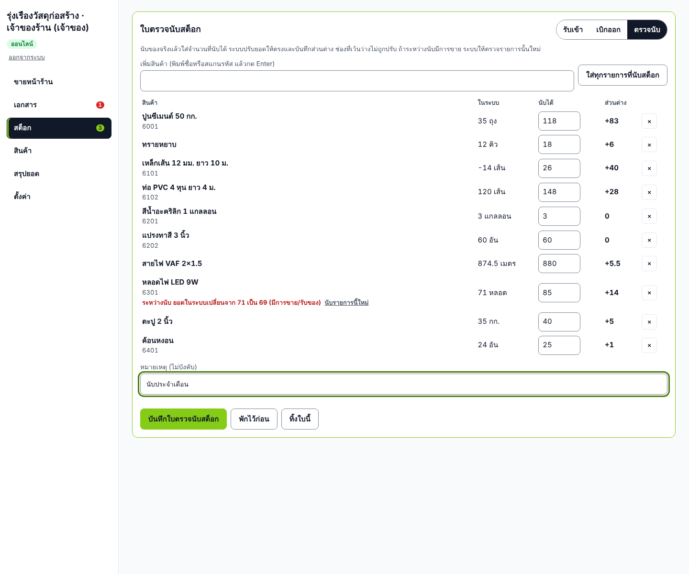
  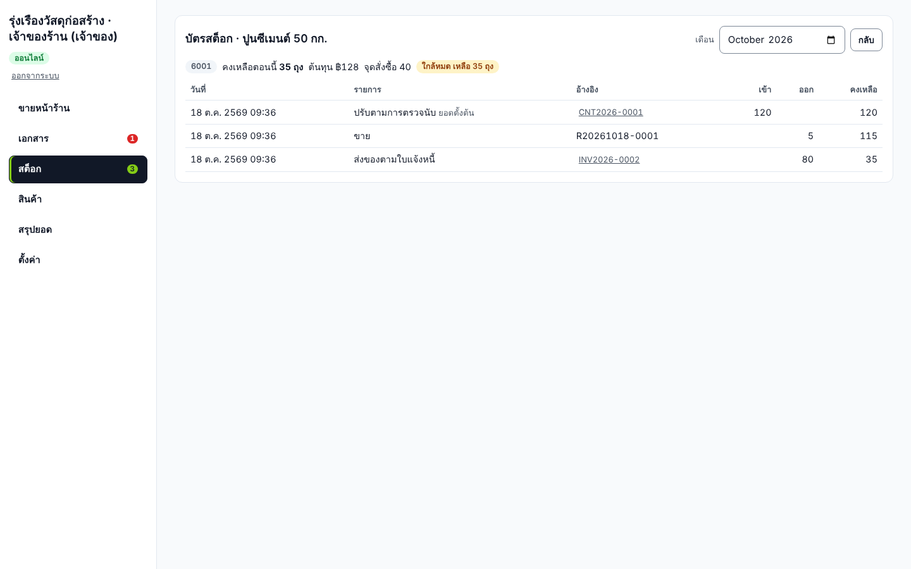
</p>

**ยังไม่มี:** รับชำระบางส่วน/มัดจำ/หัก ณ ที่จ่าย ใบวางบิลรวม ใบลดหนี้/รับคืนสินค้า ส่วนลดต่อรายการหรือเป็นเปอร์เซ็นต์ ราคารวม VAT สูตรวัตถุดิบ (กาแฟ 1 แก้วตัดเมล็ด 18 กรัม) หลายคลัง ล็อต/วันหมดอายุ ต้นทุนเฉลี่ย (ใช้ต้นทุนล่าสุด) แปลงหน่วยซื้อเป็นหน่วยขาย (ซื้อเป็นลัง ขายเป็นขวด)
> หัวเอกสารและข้อมูลบนใบกำกับภาษี ควรให้ผู้ทำบัญชีของร้านตรวจก่อนใช้เป็นเอกสารภาษีจริง

---

## ส่วนต่างๆ ของระบบ

### 1. หน้าลูกค้า (สแกน QR ที่โต๊ะ)

เปิดจากมือถือได้ทันทีโดยไม่ต้องลงแอป ออกแบบสำหรับมือถือเป็นหลัก (ตั้งแต่จอ 320 px) และปรับเป็น 2 คอลัมน์บนแท็บเล็ต

<table>
<tr>
<td width="33%" valign="top"><br><b>รายการเมนู</b><br>โทนมืดแบบร้านอาหาร (ตั้งเป็นสว่างหรือตามเครื่องลูกค้าได้) การ์ดหน้าปกมีภาพร้าน โลโก้ ชื่อร้าน คำโปรย เลขโต๊ะ และสถานะรับออเดอร์ ต่อด้วยหมวดที่มีไอคอน ช่องค้นหาเมนู และแถว "เมนูแนะนำ" ที่ร้านเลือกเอง (ไม่ได้เลือกใช้เมนูขายดีจากยอดขายจริง 7 วัน) การ์ดเมนูมีรูปด้านซ้าย ชื่อ คำอธิบาย ราคา และปุ่ม + แถบล่างไปที่ เมนู / ออเดอร์ / ร้าน ทุกหมวดเรียงต่อกันในหน้าเดียว แถบหมวดด้านบนกดเพื่อกระโดดไปหมวดนั้น และไฮไลต์ตามตำแหน่งที่เลื่อนอยู่ ปุ่ม <b>+</b> เพิ่มจานปกติลงรายการสั่งได้เร็วโดยไม่ต้องเปิดรายละเอียด</td>
<td width="33%" valign="top"><br><b>รายละเอียดเมนู</b><br>รูปใหญ่ ราคา "/ จาน" ปรับจำนวน ปุ่ม <b>เพิ่มรายการ</b> แสดงราคารวมตามจำนวน แท็บ "รายละเอียด" แสดงคำอธิบายที่ร้านเขียน ปุ่มย้อนกลับของมือถือปิดหน้านี้ ไม่ออกจากเว็บ</td>
<td width="33%" valign="top"><br><b>หมายเหตุถึงครัว</b><br>เลือกได้หลายข้อก่อนเพิ่มรายการ (ร้านกำหนดตัวเลือกเอง) เมนูเดียวกันแต่หมายเหตุต่างกันจะแยกเป็นคนละรายการ ครัวรู้ว่าจานไหนเผ็ด จานไหนไม่เผ็ด</td>
</tr>
<tr>
<td valign="top"><br><b>รายการสั่ง</b><br>แก้จำนวน แก้หมายเหตุ ฝากข้อความถึงครัว เห็นยอดรวมก่อนกดสั่ง ถ้าเน็ตสะดุดแล้วกดสั่งซ้ำ หรือรีเฟรชหน้า จะไม่เกิดออเดอร์ซ้ำ</td>
<td valign="top"><br><b>สถานะออเดอร์ของโต๊ะ</b><br>รอทำ → กำลังทำ → พร้อมเสิร์ฟ → เสิร์ฟแล้ว อัปเดตเองทุก 5 วินาที มียอดอาหารรวมและยอดประมาณการ ปุ่ม <b>เรียกพนักงาน</b> และ <b>ขอเช็คบิล</b> แจ้งขึ้นจอหลังร้านทันที</td>
<td valign="top"><br><b>เมนูหมด</b><br>เมื่อครัวกด "หมด" ลูกค้าเห็นภายใน 5 วินาที รูปเป็นสีเทา ปุ่มเปลี่ยนเป็น "หมดแล้ว" กดไม่ได้ แม้ลูกค้าเปิดหน้านั้นค้างไว้อยู่ และถ้ามีในรายการสั่งจะถูกนำออกพร้อมแจ้ง</td>
</tr>
<tr>
<td valign="top"><br><b>โทนสว่าง</b><br>ร้านเลือกโทนหน้าลูกค้าได้: มืด (ค่าเริ่มต้น) สว่าง หรือตามเครื่องลูกค้า สีทุกโทนผ่านเกณฑ์ความคมชัดของตัวอักษร</td>
<td valign="top"><br><b>เมนูที่ยังไม่มีรูป</b><br>แสดงเป็นพื้นสีจางตามหมวดพร้อมไอคอนจาน ดูตั้งใจ ไม่ใช่รูปเสีย ร้านเพิ่มรูปทีหลังได้</td>
<td valign="top"><br><b>แถบ "ดูรายการสั่ง" ด้านล่าง</b><br>แสดงจำนวนจานและยอดรวมตลอดเวลา แตะเพื่อเปิดรายการสั่ง จานที่เลือกแล้วมีตัวปรับจำนวนบนการ์ด</td>
</tr>
<tr>
<td valign="top"><br><b>ข้อมูลร้าน ติดตาม และแชร์</b><br>ปุ่ม "ร้าน" ที่แถบล่าง: ที่อยู่ เบอร์โทร เวลารับออเดอร์ ปุ่มติดตาม Facebook / Instagram / LINE / TikTok และปุ่มแชร์ร้าน (ส่งลิงก์ที่ร้านตั้ง ไม่ใช่ QR ของโต๊ะ)</td>
<td valign="top"><br><b>ค้นหาเมนู</b><br>พิมพ์ชื่อหรือส่วนผสม เช่น "กุ้ง" เห็นเฉพาะเมนูที่ตรง ไม่สนช่องว่าง</td>
<td valign="top"><br><b>โทนมืด</b><br>การ์ดหน้าปกมีภาพร้าน คำโปรย และแถวเมนูแนะนำที่ร้านเลือก</td>
</tr>
</table>

<p align="center"><br><i>บนแท็บเล็ต (768 px) การ์ดเมนูเป็น 2 คอลัมน์และจำกัดความกว้างเนื้อหา</i></p>

**กรณีพิเศษที่ระบบจัดการให้**
- **ร้านปิดรับออเดอร์ QR:** ลูกค้ายังดูเมนูได้ แต่ปุ่มสั่งกดไม่ได้ พร้อมข้อความให้เรียกพนักงาน
- **ราคาเปลี่ยนระหว่างลูกค้าเปิดรายการสั่งค้างไว้:** ระบบไม่คิดเงินตามราคาใหม่เงียบๆ จะแสดงยอดใหม่ให้ตรวจก่อนกดสั่งอีกครั้ง
- **เน็ตหลุด:** มีป้ายบอกว่าสถานะที่เห็นอาจไม่ใช่ล่าสุด และป้ายหายเองเมื่อเชื่อมต่อได้
- **สั่งเกิน 60 จาน หรือ 40 รายการในครั้งเดียว:** เตือนก่อนกดสั่ง

---

### 2. หน้าพนักงาน (`/staff`)

ใช้ได้ทั้งคอมพิวเตอร์ แท็บเล็ต และมือถือ บนจอใหญ่ (≥ 1024 px) เมนูอยู่แถบซ้าย บนมือถือเป็นแท็บด้านบน แต่ละคนเข้าด้วย PIN ของตัวเอง และเห็นเฉพาะส่วนที่บทบาทของตัวเองทำได้

#### 2.1 เข้าสู่ระบบ


- **วิธีเข้า:** ใส่ PIN ตัวเลข 6–8 หลักของตัวเอง หน้านี้แสดงโลโก้และชื่อร้าน
- **บทบาท:** มี 4 บทบาท คือเจ้าของ แคชเชียร์ พนักงานเสิร์ฟ และครัว ([ดูตารางสิทธิ์](#พนักงานและสิทธิ์))
- **กันการเดารหัส:** ใส่ผิดหลายครั้งระบบพักการเข้าสู่ระบบชั่วคราว แต่คอมพิวเตอร์ในร้านยังเข้าได้เสมอ
- **ทุกอย่างลงบันทึก:** ทุกการกระทำบันทึกชื่อคนทำ บทบาท และเครื่องที่ใช้

<br clear="right">

#### 2.2 จอครัว


- **ตั๋วออเดอร์:** ใบละโต๊ะต่อจุดทำ (ครัวร้อน / เครื่องดื่ม / ของหวาน) เรียงตามเวลา ตัวใหญ่อ่านได้จากระยะไกล ปุ่มสูง 48 px
- **ปุ่มสถานะ:** **เริ่มทำ → ทำเสร็จ → เสิร์ฟแล้ว** เดินหน้าได้ทีละขั้น ถ้าสองเครื่องกดพร้อมกัน ระบบให้เครื่องหลังรีเฟรช ไม่มีการย้อนสถานะ
- **ตัวกรองจุดทำ:** แท็บด้านบนกรองตามจุดทำ แถว "ทำรวม" บอกยอดรวมของแต่ละเมนูที่ต้องทำ
- **ออเดอร์ค้างนาน:** ขอบการ์ดเปลี่ยนสี และมีป้าย "เริ่มช้า" หรือ "รอนาน" ไม่ได้บอกด้วยสีอย่างเดียว
- **แจ้งเตือน:** เสียงแยกตามบทบาท (ครัว = ออเดอร์ใหม่ของจุดที่เลือก, หน้าร้าน = เรียกพนักงาน ขอบิล พร้อมเสิร์ฟ) 4 เสียงไม่ซ้ำกัน เตือนซ้ำทุก 1 นาทีถ้ามีเรื่องค้าง ต้องแตะจอหนึ่งครั้งหลังเปิดหน้า ([ตารางเสียง](docs/GUIDE.md#เสียงแจ้งเตือน-ทุกบทบาท))

<table><tr>
<td width="50%" valign="top"><br><b>ยกเลิกออเดอร์</b><br>ต้องเลือกเหตุผลทุกครั้ง ถ้าครัวเริ่มทำแล้ว แคชเชียร์ต้องให้เจ้าของใส่ PIN อนุมัติ เหตุผลและคนอนุมัติขึ้นในประวัติการแก้ไข ใช้ตรวจของเสียและเงินหายได้</td>
<td width="50%" valign="top"><br><b>บนมือถือ</b><br>ใช้เป็นจอครัวสำรอง หรือให้พนักงานเดินถือได้</td>
</tr></table>

#### 2.3 โต๊ะ & บิล


- **ผังโต๊ะ:** บอกสถานะด้วยทั้งสีและข้อความ: ว่าง / เปิดโต๊ะแล้ว / มีลูกค้า / พร้อมเสิร์ฟ / ขอเช็คบิล / เรียกพนักงาน
- **รายละเอียดโต๊ะ:** แตะโต๊ะเพื่อดูรายการที่สั่ง เปิด/ปิดค่าบริการ 10% และ VAT 7% ได้ หรือกด "สั่งแทนลูกค้า"
- **ใบแจ้งยอด:** มี **QR PromptPay ตามยอดจริง** ลูกค้าสแกนจ่ายได้ทันที พิมพ์ขนาด 80 มม. ได้
- **เพิ่ม/ลบโต๊ะ:** ปุ่ม "+ เพิ่มโต๊ะ" และ "− ลบโต๊ะ" ท้ายผังโต๊ะ (เจ้าของ, 1–60 โต๊ะ) ลบได้ทีละโต๊ะจากเลขสุดท้าย และต้องไม่มีออเดอร์หรือการเรียกค้าง ลบแล้วเพิ่มกลับ QR แผ่นเดิมใช้ได้อีก

<table><tr>
<td width="50%" valign="top"><br><b>รับเงินสดและเงินทอน</b><br>กด "รับเงินสด" แล้วใส่จำนวนที่รับมา หรือกดปุ่มลัดตามยอด ระบบแสดงเงินทอนตัวใหญ่ ถ้าเงินไม่พอกดยืนยันไม่ได้ ต้องกดยืนยันอีกครั้งเพื่อปิดบิล ถ้าลูกค้าสั่งเพิ่มระหว่างคิดเงิน ระบบไม่ให้ปิดบิลจนกว่าจะตรวจยอดใหม่</td>
<td width="50%" valign="top"><br><b>ใบเสร็จรับเงิน</b><br>เลขที่ใบเสร็จต่อเนื่องไม่ซ้ำ (เช่น R20261013-0004) มีโลโก้ ที่อยู่ เบอร์โทร รายการ ค่าบริการ ยอดสุทธิ เงินที่รับมา และเงินทอน พิมพ์ซ้ำได้จากหน้าสรุปยอด</td>
</tr></table>

#### 2.4 เมนู

<table><tr>
<td width="50%" valign="top"><br><b>จัดการเมนูและหมวด</b><br>เพิ่ม/แก้/ลบเมนู เลื่อนลำดับหมวด ค้นหาเมนู ตั้ง "หมด" ได้ในคลิกเดียว และแก้ตัวเลือกหมายเหตุที่ลูกค้ากดได้</td>
<td width="50%" valign="top"><br><b>แก้เมนู</b><br>ชื่อ ราคา (มีทศนิยมได้) หมวด จุดที่ทำ คำอธิบาย รูป (ถ่ายจากมือถือได้ ระบบย่อให้เอง) และซ่อนเมนูตามฤดูกาล ถ้าสองเครื่องแก้เมนูเดียวกันพร้อมกัน ระบบไม่ให้บันทึกทับกัน</td>
</tr></table>

แคชเชียร์และครัวเห็นแท็บนี้เป็น "เมนูหมด" ตั้งได้แค่ว่าเมนูไหนหมด แก้ราคาไม่ได้

#### 2.5 สรุปยอดและประวัติการแก้ไข


- **ตัวเลขหลักของวัน:** ยอดขายวันนี้ แยกเงินสด (ไว้นับเทียบลิ้นชัก) กับโอน/QR (ไว้เทียบบัญชีธนาคาร) และยอดที่ยังค้างชำระ
- **เมนูขายดีวันนี้และยอดขาย 7 วันล่าสุด:** แสดงเป็นกราฟแท่ง
- **ประวัติการแก้ไขวันนี้:** ใครยกเลิกออเดอร์ (มูลค่าเท่าไร เหตุผลอะไร) ใครแก้ราคา เปลี่ยนเบอร์ PromptPay เพิ่มพนักงาน หรือกู้คืนข้อมูล จากเครื่องไหน
  - ระบบตรวจว่าไฟล์บันทึกถูกแก้หรือลบนอกระบบหรือไม่ (ป้าย "log ครบถ้วน")
- **บิลวันนี้:** ดูใบเสร็จย้อนหลังและพิมพ์ซ้ำได้
- **ส่งยอดให้บัญชี:** ดาวน์โหลดยอดขายทั้งเดือนเป็น CSV เปิดใน Excel ได้ภาษาไทยถูกต้อง

#### 2.6 ตั้งค่า (เจ้าของเท่านั้น)


**ข้อมูลร้าน:** ชื่อ ที่อยู่ เบอร์โทร เลขผู้เสียภาษี เบอร์ PromptPay จำนวนโต๊ะ ข้อความท้ายใบเสร็จ เปิด/ปิดรับออเดอร์ผ่าน QR และค่าบริการ/VAT เริ่มต้น

<table><tr>
<td width="50%" valign="top"><br><b>หน้าตาร้าน: โลโก้ ภาพพื้นหลัง และสีปุ่ม</b><br>อัปโหลดโลโก้ (PNG พื้นใสหรือ JPG) และภาพพื้นหลังหน้าลูกค้า (ภาพแนวนอน เช่น หน้าร้าน แสดงเต็มที่หน้าปกและจางๆ ทั้งหน้า ใช้เป็นพื้นหลังหน้าใส่รหัสพนักงานด้วย) และเลือกสีปุ่ม (9 ชุดสำเร็จรูป หรือเลือกสีเอง) ดูตัวอย่างก่อนบันทึก ระบบคำนวณสีตัวหนังสือให้อ่านชัดเอง สีที่ทำให้ปุ่มกลืนกับพื้นบันทึกไม่ได้</td>
<td width="50%" valign="top"><br><b>พนักงาน</b><br>เพิ่มพนักงานพร้อมบทบาทและ PIN เปลี่ยน PIN/บทบาท ปิดบัญชีคนที่ลาออก หรือสั่งออกจากระบบทุกเครื่อง (เช่น ทำมือถือหาย) ทำแล้วเครื่องที่คนนั้นเข้าอยู่หลุดทันที</td>
</tr><tr>
<td valign="top"><br><b>สำรองและกู้คืนข้อมูล</b><br>สำรองอัตโนมัติทุก 4 ชั่วโมง (เฉพาะเมื่อมีข้อมูลเปลี่ยน) สำรองเองได้ ดาวน์โหลดไฟล์ได้ และกู้คืนได้ ก่อนกู้คืนระบบสำรองข้อมูลปัจจุบันไว้ให้เสมอ ไฟล์เดียวมีครบ: เมนู รูป ยอดขาย ตั้งค่า โลโก้ และรหัส QR ทุกโต๊ะ</td>
<td valign="top"><br><b>QR ประจำโต๊ะ</b><br>มีโลโก้และชื่อร้าน แต่ละโต๊ะมีรหัสลับของตัวเอง สั่งข้ามโต๊ะหรือเดา URL ไม่ได้ <a href="#qr-ติดโต๊ะ-พิมพ์และไฟล์">ดูวิธีพิมพ์และดาวน์โหลด</a></td>
</tr></table>

#### QR ติดโต๊ะ: พิมพ์และไฟล์


| ต้องการ | กดปุ่ม | ได้อะไร |
|---|---|---|
| พิมพ์ทุกโต๊ะทีเดียว | **พิมพ์ QR ทุกโต๊ะ (A4 หน้าละ 6 ใบ)** | กระดาษ A4 หน้าละ 6 ใบ (2×3) มีเส้นประไว้ตัด เลือก "บันทึกเป็น PDF" ในหน้าต่างพิมพ์ ได้ไฟล์ PDF รวมทุกโต๊ะ |
| พิมพ์โต๊ะเดียว (QR เสีย / เพิ่มโต๊ะใหม่) | **พิมพ์** บนการ์ดโต๊ะนั้น | ใบใหญ่หนึ่งใบกลางหน้า |
| ไฟล์รูปทีละโต๊ะ | **ดาวน์โหลด PNG** บนการ์ด | `QR-โต๊ะ-5.png` 1200×1600 px (ประมาณ 10×13.5 ซม. ที่ 300 dpi) มีโลโก้ ชื่อร้าน เลขโต๊ะ และเส้นประไว้ตัด |
| ไฟล์ทุกโต๊ะส่งร้านพิมพ์ | **ดาวน์โหลดทุกโต๊ะ (.zip)** | ไฟล์ .zip เดียว ข้างในเป็น PNG ทุกโต๊ะเรียงเลข (`QR-โต๊ะ-01.png` …) |

- **ก่อนพิมพ์จริง:** ลองสแกน QR โต๊ะ 1 ด้วยมือถือที่ต่อ WiFi ร้านก่อนเสมอ ถ้าที่อยู่ใน QR เป็น `localhost` ระบบจะเตือน
- **ความทนทาน:** แนะนำเคลือบพลาสติก หรือใส่ป้ายตั้งโต๊ะอะคริลิก
- **ห้ามแชร์รูป QR ออกนอกร้าน:** ใน QR มีรหัสลับของโต๊ะ ถ้ารูปโต๊ะไหนหลุด กด **เปลี่ยนรหัส** บนการ์ดโต๊ะนั้นแล้วพิมพ์แผ่นใหม่ (โต๊ะอื่นไม่กระทบ)

<br clear="right">

#### 2.7 ยืนยันก่อนลบข้อมูล


- **ทุกการลบหรือแทนที่ข้อมูลมีหน้าต่างยืนยัน:** ลบเมนู ลบหมวด ลบโต๊ะ เอาโลโก้ออก เอาภาพพื้นหลังออก เลิกใช้รูป QR รับเงิน เปลี่ยนรหัส QR ปิดบัญชีพนักงาน และกู้คืน
- **บอกชัดก่อนกด:** หน้าต่างบอกว่าจะลบอะไร มีผลอะไรตามมา และย้อนกลับได้หรือไม่
- **กันกดพลาด:** ปุ่มที่ถูกเลือกไว้ก่อนคือ "ไม่ลบ" กด Enter หรือ Esc ก็ไม่มีอะไรหาย

#### 2.8 บทบาทและโหมดมืด

<table><tr>
<td width="50%" valign="top"><br><b>มุมมองแคชเชียร์</b><br>เห็นเฉพาะ ครัว / โต๊ะ & บิล / เมนูหมด / สรุปยอด ไม่มีตั้งค่า แก้ราคา หรือสำรองข้อมูล สิทธิ์ตรวจที่เซิร์ฟเวอร์ ไม่ใช่แค่ซ่อนปุ่ม</td>
<td width="50%" valign="top"><br><b>โหมดมืด</b><br>สำหรับร้านที่เปิดกลางคืนหรือจอครัวที่ไม่อยากให้แสบตา</td>
</tr></table>

---

## ติดตั้งและเริ่มใช้งาน

### 1. ติดตั้ง

ต้องมี Node.js 18 ขึ้นไป (ดาวน์โหลดรุ่น LTS จาก https://nodejs.org) ไม่ต้อง `npm install`

```bash
npm test                                              # ตรวจว่าระบบพร้อม (ควรผ่านทั้งหมด)
STAFF_PIN=รหัสอย่างน้อย6หลัก node server.js            # Mac / Linux
set "STAFF_PIN=รหัสอย่างน้อย6หลัก" && node server.js   # Windows (cmd) ใส่ "" ด้วย ไม่อย่างนั้น cmd เก็บช่องว่างไว้ใน PIN
```

- **หน้าพนักงาน:** `http://localhost:3000/staff`
- **ที่อยู่สำหรับลูกค้า:** `http://192.168.x.x:3000` ระบบพิมพ์ที่อยู่นี้ให้ตอนเปิด มือถือต้องต่อ WiFi เดียวกับเครื่องร้าน
- **ให้ระบบเปิดเองตอนเปิดเครื่อง:** ดูตัวอย่าง `start.bat` (Windows) และ systemd (Linux) ใน [AGENTS.md](AGENTS.md#ให้ระบบเปิดเองตอนเปิดเครื่อง)

| ตัวแปร | ใช้ทำอะไร |
|---|---|
| `STAFF_PIN` | PIN ของบัญชีเจ้าของร้าน (ค่าเริ่มต้น 1234 **ต้องเปลี่ยน** ระบบจะเตือนบนหน้าจอ) |
| `BACKUP_DIR` | โฟลเดอร์ที่คัดลอกไฟล์สำรองไปเก็บอีกที่ เช่น Google Drive (แนะนำอย่างยิ่ง) |
| `BACKUP_EVERY_MIN` | สำรองอัตโนมัติทุกกี่นาที (ค่าเริ่มต้น 240 = 4 ชั่วโมง) |
| `PORT` | พอร์ต (ค่าเริ่มต้น 3000) |
| `DATA_DIR` | โฟลเดอร์เก็บข้อมูล (ค่าเริ่มต้น โฟลเดอร์โปรแกรม) |
| `TRUST_PROXY=1` | ใช้เมื่อเปิดผ่าน Cloudflare Tunnel บนเครื่องเดียวกัน (ต้องตั้ง PIN ≥ 6 หลัก) |
| `ORDER_LIMIT` | ลูกค้าสั่งได้กี่ครั้งต่อนาทีต่อเครื่อง (ค่าเริ่มต้น 8) |
| `OWNER_SESSION_MIN` | เจ้าของต้องเข้าสู่ระบบใหม่ทุกกี่นาที (ค่าเริ่มต้น 720 = 12 ชั่วโมง) |
| `REAUTH_SEC` | ใส่ PIN ซ้ำแล้วทำเรื่องสำคัญต่อได้กี่วินาที (ค่าเริ่มต้น 300 = 5 นาที) |

### 2. ตั้งค่าครั้งแรก (ประมาณ 30 นาที)

1. **แท็บตั้งค่า:**
   - ใส่ชื่อร้าน ที่อยู่ เบอร์โทร เลขผู้เสียภาษี (ถ้ามี) เบอร์ PromptPay และจำนวนโต๊ะ
   - ใส่โลโก้ ภาพพื้นหลังหน้าลูกค้า และเลือกสีปุ่มในส่วน "หน้าตาร้าน"
2. **แท็บเมนู:** แก้เมนูตัวอย่างให้เป็นเมนูจริงของร้าน ใส่รูปอาหาร ไม่มีรูปก็ใช้ได้ เพิ่มทีหลังได้
3. **ที่อยู่ใน QR:** ถ้าเป็น `localhost` ให้ใส่ `http://192.168.x.x:3000` ในช่อง "ที่อยู่เว็บที่ใส่ใน QR"
4. **IP คงที่:** ตั้ง IP ของเครื่องร้านให้คงที่ในเราเตอร์ (DHCP reservation) ไม่อย่างนั้น QR ที่พิมพ์ไว้จะเสียเมื่อ IP เปลี่ยน
5. **ลองสแกน:** สแกน QR โต๊ะ 1 ด้วยมือถือที่ต่อ WiFi ร้าน ลองสั่งจริง แล้วค่อยกด "พิมพ์ QR ทุกโต๊ะ"
6. **ลองจ่ายจริง:** จ่าย PromptPay 1 บาทจาก QR บนใบแจ้งยอด เพื่อยืนยันว่าเงินเข้าบัญชีถูก
7. **เพิ่มพนักงาน:** เพิ่มพนักงานแต่ละคนพร้อม PIN ของตัวเอง
8. **ทดสอบสำรองข้อมูล:** ตั้ง `BACKUP_DIR` ไปที่โฟลเดอร์ Google Drive แล้วกด "สำรองข้อมูลตอนนี้" เช็กว่าไฟล์ไปถึง

---

## คู่มือการใช้งานรายวัน

> **วิธีใช้งานทีละขั้นของทุกส่วน** (ลูกค้าสั่งอาหาร, ครัว, แคชเชียร์รับเงิน/ยกเลิกออเดอร์, จัดการเมนู, สรุปยอดและปิดร้าน, ตั้งค่า, พนักงาน, สำรองข้อมูล, QR ติดโต๊ะ, เหตุการณ์ไม่ปกติ และสรุปย่อติดผนัง) อยู่ใน **[docs/GUIDE.md](docs/GUIDE.md)**

### งานประจำวัน

| ช่วงเวลา | ทำอะไร |
|---|---|
| **เปิดร้าน** | เปิดโปรแกรม แตะจอครัวหนึ่งครั้งเพื่อเปิดเสียงเตือน ตรวจว่าป้ายมุมบนเป็น "ออนไลน์" |
| **ระหว่างวัน** | ครัวกดสถานะตามจริง ของหมดให้กด "ตั้งเป็นหมด" ทันที ยกเลิกออเดอร์ต้องใส่เหตุผล |
| **ปิดบิล** | เลือกโต๊ะ → ตรวจยอด → "รับเงินสด" (ใส่เงินที่รับมา ระบบบอกเงินทอน) หรือ "รับโอน / QR" → กดยืนยันอีกครั้ง → พิมพ์ใบเสร็จ |
| **ปิดร้าน** | ปิด "รับออเดอร์ผ่าน QR" → แท็บสรุปยอด: นับเงินในลิ้นชักเทียบยอดเงินสด ยอดโอนเทียบบัญชี → ดูประวัติการแก้ไข |
| **สิ้นเดือน** | ดาวน์โหลดยอดขายเดือนนี้ (CSV) ส่งนักบัญชี และดาวน์โหลดไฟล์สำรองเก็บอีกที่ |

### จัดการเมนู
- **แก้ราคา:** มีผลกับออเดอร์ใหม่เท่านั้น ออเดอร์ที่สั่งไปแล้วคิดราคาเดิม
- **ซ่อนเมนู:** ใช้กับเมนูตามฤดูกาล ลูกค้าไม่เห็น แต่ข้อมูลยังอยู่
- **ตั้งเป็นหมด:** ใช้ตอนวัตถุดิบหมดระหว่างวัน ลูกค้าเห็นภายใน 5 วินาที
- **หมวดหมู่:** ลบได้เมื่อไม่มีเมนูในหมวดแล้ว
- **อัปเดตเอง:** หน้าลูกค้าที่เปิดอยู่จะได้เมนู สี และโลโก้ใหม่เอง ไม่ต้องสแกนใหม่
- **`menu.json`:** ใช้เป็นเมนูตั้งต้นตอนเปิดระบบครั้งแรกครั้งเดียวเท่านั้น

### พนักงานและสิทธิ์

| บทบาท | ทำอะไรได้ |
|---|---|
| เจ้าของ | ทุกอย่าง: ตั้งค่าร้าน หน้าตาร้าน แก้เมนู/ราคา สำรอง/กู้คืน ดูประวัติการแก้ไข จัดการพนักงาน อนุมัติการยกเลิกออเดอร์ |
| แคชเชียร์ | จอครัว โต๊ะ & บิล รับเงิน ยกเลิกออเดอร์ (ถ้าครัวทำแล้วต้องมี PIN เจ้าของ) สั่งแทนลูกค้า ตั้งเมนูหมด สรุปยอดวันนี้ |
| พนักงานเสิร์ฟ | จอครัว (เสิร์ฟ) โต๊ะ: เห็นโต๊ะที่เรียก/ขอบิล กดรับทราบ เปิดโต๊ะ สั่งแทนลูกค้า เปิดใบแจ้งยอดให้ลูกค้าดู/พิมพ์ ตั้งเมนูหมด **รับเงิน ยกเลิกออเดอร์ และดูสรุปยอดไม่ได้** |
| ครัว | จอครัว เปลี่ยนสถานะอาหาร ตั้งเมนูหมด |

- **บัญชีเจ้าของร้าน:** คือ `STAFF_PIN` ใช้เข้าได้เสมอ ลบไม่ได้ กันเจ้าของล็อกตัวเองออก
- **PIN พนักงาน:** ตัวเลข 6–8 หลัก ห้ามซ้ำกัน ระบบเก็บแบบเข้ารหัส ไม่เก็บตัว PIN
- **บังคับออกจากระบบ:** เปลี่ยน PIN เปลี่ยนบทบาท หรือปิดบัญชีแล้ว เครื่องที่คนนั้นเข้าอยู่หลุดทันที

### สำรองข้อมูล
- **ไฟล์เดียวครบทุกอย่าง:** ไฟล์สำรองเป็น `.json.gz` ร้านที่ใช้มา 1 ปีไฟล์ละประมาณ 5 MB สำรองใช้เวลาไม่ถึง 1 วินาที ระหว่างนั้นลูกค้ายังสั่งได้ตามปกติ
- **การเก็บย้อนหลัง:** เก็บทุกไฟล์ของ 2 วันล่าสุด และวันละไฟล์ย้อนหลังอีก 30 วัน
- **ย้ายเครื่อง:** ติดตั้งบนเครื่องใหม่ เปิดระบบ แล้วกู้คืนจากไฟล์สำรอง QR ที่พิมพ์ไว้ใช้ต่อได้เลย
- **อย่าเก็บไว้เครื่องเดียว:** ไฟล์สำรองที่อยู่บนเครื่องเดียวกับระบบหายพร้อมเครื่องได้ ให้ตั้ง `BACKUP_DIR` ไปที่ Google Drive for desktop

```bash
BACKUP_DIR="/Users/ชื่อคุณ/Google Drive/My Drive/ordervai-backup" STAFF_PIN=... node server.js   # Mac
set "BACKUP_DIR=G:\My Drive\ordervai-backup" && set "STAFF_PIN=..." && node server.js                # Windows
```

ไฟล์สำรองมีรหัส QR และข้อมูลร้าน เก็บเป็นความลับ อย่าแชร์

### ประวัติการแก้ไข (Log)
- **บันทึก 3 ชนิด:**
  - การแก้ไขข้อมูล (เงิน ออเดอร์ เมนู ตั้งค่า สิทธิ์) เก็บ 25 เดือน
  - การเข้าสู่ระบบ เก็บ 6 เดือน
  - ข้อผิดพลาดของระบบ เก็บ 3 เดือน
- **แก้หรือลบจากหน้าเว็บไม่ได้:** ถ้ามีคนแก้ไฟล์ในเครื่อง หน้าสรุปยอดจะขึ้น "ตรวจพบการแก้ไข log"
- **ไม่บันทึกข้อมูลลับ:** ไม่มี PIN, cookie หรือรหัส QR ใน log
- **รหัสอ้างอิง:** ถ้าหน้าจอขึ้นข้อผิดพลาดพร้อม "รหัสอ้างอิง" ให้จดไว้ ใช้ค้นหาใน log ได้

### ข้อมูลอยู่ที่ไหน

| ที่เก็บ | มีอะไร |
|---|---|
| `data.json` | เมนู/สินค้า (รวมยอดคงเหลือ) การตั้งค่า ออเดอร์ที่เปิดอยู่ รหัส QR พนักงาน ยอดขาย 8 วันล่าสุด รายชื่อลูกค้า/ผู้ขาย เอกสารที่ยังค้าง |
| `data.json.bak` | สำเนาตอนเปิดระบบครั้งล่าสุด ถ้า `data.json` เสีย ระบบกู้จากไฟล์นี้เอง |
| `images/` | รูปอาหาร โลโก้ ภาพพื้นหลัง และรูป QR รับเงิน |
| `sales/YYYY-MM.jsonl` | ยอดขายทุกบิล แยกรายเดือน เก็บถาวร |
| `journal/` | เอกสารทุกฉบับ (`docs-YYYY-MM.jsonl`) และความเคลื่อนไหวสต็อกทุกครั้ง (`stock-YYYY-MM.jsonl`) แยกรายเดือน เก็บถาวร อยู่ในไฟล์สำรองด้วย |
| `backups/` | ไฟล์สำรองอัตโนมัติและที่กดเอง |
| `logs/` | ประวัติการแก้ไข การเข้าสู่ระบบ ข้อผิดพลาด แยกไฟล์รายเดือน |

---

## รีวิวระบบ

> รีวิวโดยประเมินจากโค้ด ผลการทดสอบอัตโนมัติ และการทดสอบบนเบราว์เซอร์จริง (ตุลาคม 2569) ฉบับเต็มอยู่ที่ [docs/REVIEW.md](docs/REVIEW.md)

### ข้อดี

| ด้าน | รายละเอียด |
|---|---|
| **ไม่ง้ออินเทอร์เน็ต** | ทุกอย่างรันในร้าน ใช้แค่ WiFi เน็ตล่ม ร้านก็ยังรับออเดอร์ได้ ไม่มีค่าบริการรายเดือน ไม่มีค่าธรรมเนียมต่อออเดอร์ |
| **ติดตั้งง่ายมาก** | มีแค่ Node.js ไม่มีฐานข้อมูล ไม่มี dependency ไม่ต้อง build ย้ายเครื่องด้วยไฟล์สำรองไฟล์เดียว |
| **ลูกค้าใช้ง่าย** | สแกนแล้วสั่งได้เลย ไม่ต้องลงแอปหรือสมัครสมาชิก หน้าตาแบบแอปสมัยใหม่ ใช้ได้ตั้งแต่จอ 320 px รองรับโหมดมืด |
| **เงินไม่รั่ว** | ราคาคิดที่เซิร์ฟเวอร์เท่านั้น ปิดบิลไม่ได้ถ้ายอดเปลี่ยนระหว่างคิดเงิน เลขใบเสร็จไม่ซ้ำไม่ย้อน ยกเลิกต้องมีเหตุผลและอนุมัติ ทุกการแก้ไขมี log ที่ตรวจการแก้ไขย้อนหลังได้ |
| **ข้อมูลไม่หาย** | บันทึกลงดิสก์ก่อนตอบว่าสำเร็จ ทดสอบด้วยการบังคับปิดโปรแกรม 20 รอบระหว่างออเดอร์เข้า: ออเดอร์ที่ตอบสำเร็จไม่หายเลย มีสำรองข้อมูลอัตโนมัติและกู้คืนได้ปลอดภัย |
| **แยกสิทธิ์ชัดเจน** | PIN รายคน 4 บทบาท ตรวจสิทธิ์ที่เซิร์ฟเวอร์ทุก endpoint (มีเทสต์ไล่ตรวจอัตโนมัติ) |
| **ตรงกับร้านไทย** | PromptPay QR ตามยอด ค่าบริการ 10% / VAT 7% ใบเสร็จ 80 มม. CSV เปิดใน Excel ภาษาไทยไม่เพี้ยน ใบเสนอราคา ใบส่งของ/ใบแจ้งหนี้/ใบกำกับภาษี ใบเสร็จ A4 จำนวนเงินเป็นตัวหนังสือ วันที่ พ.ศ. |
| **สต็อกตรวจสอบได้** | ยอดคงเหลือเปลี่ยนได้ทางเอกสารหรือบิลเท่านั้น ทุกครั้งมีบัตรสต็อกย้อนดูได้ ตรวจนับระหว่างร้านยังขายอยู่ก็ไม่ทับยอดผิด |
| **ปรับแบรนด์ได้** | โลโก้และสีปุ่มของร้าน ระบบคุมความคมชัดของตัวอักษรให้อัตโนมัติ |
| **ทดสอบหนัก** | เทสต์อัตโนมัติ 112 เคส ทดสอบบนเบราว์เซอร์จริง 290 ข้อ ตรวจการเข้าถึง WCAG 2.2 AA ทดสอบประสิทธิภาพด้วยข้อมูล 1 ปี และทดสอบเฉพาะ Windows |

### ข้อจำกัด

| ด้าน | รายละเอียด | ผลกระทบ |
|---|---|---|
| **เครื่องเดียว** | ทุกอย่างอยู่บนคอมพิวเตอร์ในร้านเครื่องเดียว ถ้าเครื่องเสีย ระบบหยุดจนกว่าจะกู้บนเครื่องใหม่ | สูง: ต้องมี `BACKUP_DIR` และเครื่องสำรอง |
| **ต้องต่อ WiFi ร้าน** | ลูกค้าต้องต่อ WiFi ร้าน ถ้าจะใช้เน็ตมือถือต้องตั้ง Cloudflare Tunnel เพิ่ม และควรมีโหมดพนักงานยืนยันออเดอร์ก่อน | กลาง |
| **ฟีเจอร์ POS ยังไม่ครบ** | ยังไม่มี: ยกเลิกทีละรายการ, ย้าย/รวมโต๊ะ, ส่วนลด, คืนเงินบิลที่ปิดแล้ว, ตัวเลือกเสริมที่มีราคา (เพิ่มไข่ +10), เปิด/ปิดกะนับลิ้นชัก | กลาง: ร้านต้องจัดการบางเรื่องนอกระบบ |
| **ภาษีและบัญชี** | ใบส่งของ/ใบแจ้งหนี้ของร้านที่จด VAT เป็นใบกำกับภาษี (มีชื่อ ที่อยู่ เลขผู้เสียภาษี สาขาทั้งสองฝ่าย) แต่ยังไม่มีโหมดราคารวม VAT ใบลดหนี้ และหัก ณ ที่จ่าย ควรให้นักบัญชีตรวจก่อนใช้เป็นเอกสารภาษี | กลาง: สำหรับร้านที่จด VAT |
| **สต็อกแบบพื้นฐาน** | ตัดสต็อกตามการขาย รับเข้า เบิก ตรวจนับ บัตรสต็อกครบ แต่ยังไม่มีสูตรวัตถุดิบ หลายคลัง ล็อต/วันหมดอายุ ต้นทุนเฉลี่ย | ต่ำสำหรับร้านค้าเล็กถึงกลาง · กลางสำหรับร้านขายยา (ล็อต/วันหมดอายุ) และร้านอาหารที่ต้องคุมวัตถุดิบ |
| **ขายหน้าร้านยังไม่ครบแบบ POS เต็มรูป** | ยังไม่มีส่วนลดที่หน้าขาย สมาชิก/แต้ม ตัวเลือกเสริมที่มีราคาและไซซ์ (ใช้สินค้าแยกรายการแทน) รับชำระบางส่วน | กลาง |
| **ขนาดร้าน** | หน้าพนักงานโหลดข้อมูลทั้งก้อนทุกครั้งที่มีการเปลี่ยนแปลง เหมาะกับหลักสิบโต๊ะ (สูงสุด 60) ไม่รองรับหลายสาขา | ต่ำ: สำหรับร้านเป้าหมาย |
| **ไฟดับจริง** | การเขียนไฟล์ยังไม่ fsync ไฟดับกะทันหันอาจทำให้ไฟล์ล่าสุดเสีย (ระบบกู้จาก .bak ให้เอง แต่ข้อมูลอาจย้อนไปถึงตอนเปิดเครื่อง) | ต่ำ: แนะนำใช้ UPS |
| **ยังไม่ได้ทดสอบกับเครื่องจริง** | (การพิมพ์ใบเสร็จตรวจแล้วด้วยการพิมพ์เป็น PDF ขนาดกระดาษ 80 มม. ส่วนเครื่องพิมพ์ความร้อนจริงยังไม่ได้ลอง ดู[วิธีตั้งเครื่องพิมพ์](docs/GUIDE.md#ตั้งเครื่องพิมพ์ใบเสร็จ-ทำครั้งเดียว)) iPhone/Android จริง, VoiceOver/TalkBack, เครื่องพิมพ์ใบเสร็จความร้อน, Linux/macOS | ควรทดสอบในร้านก่อนเปิดใช้เต็มรูปแบบ |

### เหมาะกับร้านแบบไหน
- **เหมาะมาก:** ร้านอาหารนั่งทาน 5–40 โต๊ะ ร้านเดียว เจ้าของดูแลเอง ต้องการลดงานจดออเดอร์และความผิดพลาด ไม่อยากจ่ายค่าบริการรายเดือน
- **เหมาะ:** ร้านกาแฟ/ชานม/เบเกอรี่ที่ขายหน้าเคาน์เตอร์และเรียกคิว ร้านของสดที่ขายตามน้ำหนัก ร้านรับซื้อของ ร้านเสริมสวย ร้านค้าปลีก ร้านขายส่งและอุปกรณ์ก่อสร้างร้านเดียวที่ต้องการตัดสต็อก ออกใบเสนอราคา ใบส่งของ/ใบแจ้งหนี้ให้ลูกค้าเครดิต
- **เหมาะ แต่ต้องเตรียมเพิ่ม:** ร้านที่จด VAT (ให้นักบัญชีตรวจใบเสร็จ) ร้านที่ต้องการให้ลูกค้าใช้เน็ตมือถือ (ตั้ง Tunnel + โหมดยืนยันออเดอร์)
- **ยังไม่เหมาะ:** ร้านหลายสาขา/หลายคลัง มินิมาร์ทใหญ่ (หลายหมื่นรายการ) ร้านขายยาที่ต้องคุมล็อตและวันหมดอายุ ร้านที่ต้องการสมาชิก/แต้ม/เดลิเวอรี ร้านที่ไม่มีคนดูแลคอมพิวเตอร์และการสำรองข้อมูลเลย

### คำแนะนำก่อนเปิดใช้จริง
1. **PIN:** ตั้ง `STAFF_PIN` อย่างน้อย 6 หลัก และให้พนักงานทุกคนมี PIN ของตัวเอง
2. **สำรองข้อมูล:** ตั้ง `BACKUP_DIR` ไป Google Drive และลองกู้คืนบนเครื่องอื่นหนึ่งครั้ง
3. **ไฟฟ้า:** ใช้ UPS กับเครื่องร้าน
4. **เครือข่าย:** ตั้ง IP เครื่องร้านให้คงที่ก่อนพิมพ์ QR
5. **ทดลองก่อนเปิดจริง:** ลองใช้งานจริง 1–2 วันกับพนักงาน ทั้งมือถือลูกค้าหลายรุ่นและเครื่องพิมพ์ใบเสร็จ

---

## ความปลอดภัยและความน่าเชื่อถือของข้อมูล

**กันออเดอร์ปลอมและการแกล้ง** (เปิดใช้ในแท็บตั้งค่า > กันออเดอร์ปลอม)
- **ต้องเปิดโต๊ะก่อนลูกค้าสั่ง:** QR ของโต๊ะว่างสั่งไม่ได้จนกว่าพนักงานกด **เปิดโต๊ะ** (แท็บโต๊ะ & บิล) ปิดบิลแล้วโต๊ะปิดเอง ต่อให้มีคนถ่ายรูป QR ไปก็สั่งเข้าโต๊ะว่างไม่ได้ ลูกค้ายังกดเรียกพนักงานได้
- **ปิดรับ QR อัตโนมัตินอกเวลา:** ตั้งเวลารับออเดอร์ (ปิดหลังเที่ยงคืนได้) นอกเวลาลูกค้าสั่งไม่ได้ หน้าพนักงานมีป้ายบอก
- **เปลี่ยนรหัส QR ทีละโต๊ะ:** ปุ่ม **เปลี่ยนรหัส** บนการ์ด QR ใช้เมื่อรูป QR หลุดออกไป QR แผ่นเก่าของโต๊ะนั้นใช้ไม่ได้ทันที
- **ใส่ PIN ซ้ำก่อนเรื่องสำคัญ:** ก่อนเปลี่ยนเบอร์ PromptPay, เปลี่ยนที่อยู่ใน QR, จัดการพนักงาน, ดาวน์โหลดไฟล์สำรอง, กู้คืน, เปลี่ยนรหัส QR, เปลี่ยนลิงก์โซเชียล/ลิงก์แชร์, อัปโหลด/เลิกใช้รูป QR รับเงิน ระบบขอ PIN อีกครั้ง (ยืนยันแล้วใช้ได้ 5 นาทีบนเครื่องนั้น) cookie ที่ถูกขโมยไปจึงทำเรื่องเหล่านี้ไม่ได้ และเจ้าของต้องเข้าสู่ระบบใหม่ทุก 12 ชั่วโมง
- **ทุกครั้งที่มีคนพยายามสั่งเข้าโต๊ะที่ยังไม่เปิด หรือสั่งนอกเวลา** ถูกบันทึกในบันทึกความปลอดภัย

**ระบบทั่วไป**

- **รหัส QR ประจำโต๊ะ:** QR แต่ละโต๊ะมีรหัสลับของตัวเอง เดารหัสผิดเกิน 30 ครั้งต่อนาทีจากเครื่องเดียวถูกพัก 1 นาที
- **กันเดา PIN:** ใส่ PIN ผิดรวมเกิน 30 ครั้งต่อนาที (ทุกเครื่องรวมกัน) ระบบพักการเข้าสู่ระบบ 1 นาที เครื่องร้านยังเข้าได้เสมอ
- **ราคา:** คิดจากเมนูในเซิร์ฟเวอร์เสมอ แก้ราคาจากมือถือไม่ได้ ถ้าราคาเปลี่ยนระหว่างลูกค้าสั่ง ลูกค้าเห็นยอดใหม่ก่อนกดสั่งอีกครั้ง
- **กันสั่งซ้ำ:** เน็ตสะดุดแล้วกดสั่งซ้ำไม่เกิดออเดอร์ซ้ำ แม้ลูกค้ารีเฟรชหน้าก่อนกดใหม่
- **บันทึกก่อนตอบ:** ออเดอร์และบิลถูกบันทึกลงเครื่องก่อนลูกค้า/พนักงานเห็นว่าสำเร็จ
- **ตรวจไฟล์จริง:** อัปโหลดรูปและโลโก้ตรวจเนื้อไฟล์จริง ไม่ใช่แค่นามสกุล
- **ข้อความจากผู้ใช้:** ชื่อเมนู ข้อความลูกค้า และชื่อร้าน แสดงเป็นข้อความธรรมดาเสมอ (ทดสอบด้วยโค้ดโจมตี XSS)
- **CSV:** ไฟล์ CSV กันสูตร Excel ที่อันตราย
- **ยืนยันก่อนลบทุกครั้ง:** ลบเมนู ลบหมวด ลบโต๊ะ เอาโลโก้ออก เอาภาพพื้นหลังออก เลิกใช้รูป QR รับเงิน เปลี่ยนรหัส QR ปิดบัญชีพนักงาน และกู้คืนข้อมูล ขึ้นหน้าต่างบอกว่าจะลบอะไร ย้อนได้ไหม ปุ่มที่เลือกไว้ก่อนคือ "ไม่ลบ" (กด Enter พลาดก็ไม่ลบ) รับเงินต้องกดยืนยันสองครั้ง ยกเลิกออเดอร์ต้องมีเหตุผล
- **PIN อนุมัติ:** ช่อง PIN เจ้าของในหน้าต่างยกเลิกออเดอร์ นับรวมเพดานเดารหัสเดียวกับหน้าเข้าสู่ระบบ
- **เปิดซ้อนไม่ได้:** ระบบไม่ยอมให้เปิดโปรแกรมซ้อนบนข้อมูลชุดเดียวกัน กันเลขบิลซ้ำและข้อมูลเขียนทับกัน

---

## แก้ปัญหาที่พบบ่อย

| อาการ | วิธีแก้ |
|---|---|
| ลูกค้าสแกน QR แล้วเปิดไม่ได้ | มือถือไม่ได้ต่อ WiFi ร้าน / QR ชี้ localhost หรือ IP เก่า (แก้ "ที่อยู่เว็บที่ใส่ใน QR") / ไฟร์วอลล์ของเครื่องบล็อกพอร์ต |
| ลูกค้าเห็น "QR ของโต๊ะไม่ถูกต้อง" | data.json ถูกลบแล้วสร้างใหม่ → กู้คืนจากไฟล์สำรอง หรือพิมพ์ QR ใหม่ |
| "ระบบเปิดอยู่แล้วในอีกหน้าต่างหนึ่ง" | ใช้หน้าต่างเดิม หรือปิดก่อนแล้วเปิดใหม่ ห้ามแก้ด้วยการเปลี่ยนพอร์ต |
| ป้ายแดง "บันทึกข้อมูลลงเครื่องไม่สำเร็จ" | อย่าปิดโปรแกรม ดิสก์เต็มหรือมีโปรแกรมล็อกไฟล์ (มักเป็น Google Drive ที่ sync โฟลเดอร์ข้อมูลตรงๆ ให้ใช้ `BACKUP_DIR` แทน) แก้แล้วป้ายหายเอง ระหว่างนั้นดาวน์โหลดไฟล์สำรองไว้ |
| ไม่มีเสียงแจ้งเตือนในครัว | แตะหน้าจอหนึ่งครั้ง (เบราว์เซอร์บังคับ) มีป้ายเหลืองบอกอยู่  ปิดสวิตช์เงียบของ iPhone/iPad และตั้งจอไม่ให้ดับเอง ([เสียงแต่ละแบบและใครได้ยิน](docs/GUIDE.md#เสียงแจ้งเตือน-ทุกบทบาท)) |
| โฟลเดอร์ชื่อแปลกๆ โผล่ใน BACKUP_DIR | start.bat มีภาษาไทยแต่ไม่มี `chcp 65001 >nul` บรรทัดที่สอง |
| หลังอัปเดตต้องเข้าสู่ระบบใหม่ | ปกติสำหรับเจ้าของ (cookie เจ้าของมีวันหมดอายุ ทุก 12 ชั่วโมง) แท็บเล็ตของบทบาทอื่นไม่หลุด |

---

## สำหรับนักพัฒนา

```bash
npm test                    # ชุดทดสอบหลัก 105 เคส ไม่ต้องติดตั้งอะไร (~40 วินาที)
cd qa && npm install        # ครั้งแรก: เครื่องมือทดสอบบนเบราว์เซอร์ (ไม่เกี่ยวกับระบบหลัก)
node qa/browser.js all      # ทดสอบบนเบราว์เซอร์จริง 254 ข้อ (ไม่มี Edge: QA_BROWSER_PATH=<ไฟล์ chromium>)
node qa/a11y.js             # ตรวจการเข้าถึง WCAG 2.2 AA
node qa/docs-shots.js       # สร้างภาพหน้าจอในเอกสารนี้ใหม่
```

| ไฟล์ | หน้าที่ |
|---|---|
| `server.js` | เปิดเซิร์ฟเวอร์ ไฟล์หน้าเว็บ รูป `/theme.css` และส่งต่อคำขอไป API |
| `lib/config.js` | ค่าตั้งต้นและตัวแปร environment ทั้งหมด |
| `lib/util.js` | วันที่ เขียนไฟล์แบบปลอดภัย อ่านคำขอ HTTP |
| `lib/store.js` | ข้อมูลร้าน การบันทึก การตรวจซ่อมข้อมูลเสีย การคำนวณบิล |
| `lib/log.js` | ประวัติการแก้ไข การเข้าสู่ระบบ ข้อผิดพลาด (hash chain กันแก้ไข) |
| `lib/backup.js` | สำรองและกู้คืนข้อมูล |
| `lib/theme.js` | คำนวณสีร้านให้ผ่านเกณฑ์ความคมชัด |
| `lib/biz.js` | ประเภทธุรกิจ 14 แบบ: คำในหน้าจอ วิธีขายเริ่มต้น สินค้าตัวอย่าง |
| `lib/routes.js` | API ทั้งหมดของลูกค้าและพนักงาน สิทธิ์ตามบทบาท |
| `public/` | หน้าลูกค้า (`customer.html`) หน้าพนักงาน (`staff.html`) ไม่มี framework ไม่มี build |
| `test/`, `qa/` | ชุดทดสอบอัตโนมัติ และสคริปต์ QA (เบราว์เซอร์ ประสิทธิภาพ ข้อมูล 1 ปี Windows) |

- **[AGENTS.md](AGENTS.md):** โครงสร้าง โมเดลข้อมูล API และกฎ 65 ข้อที่ห้ามทำพัง (แต่ละข้อมาจากบั๊กจริง)
- **[QA-LOG.md](QA-LOG.md):** สิ่งที่ทดสอบแล้ว บั๊กที่แก้ และงานที่ต้องทำต่อ
- **[docs/GUIDE.md](docs/GUIDE.md):** คู่มือการใช้งานทีละขั้น แยกตามหน้าที่
- **[docs/REVIEW.md](docs/REVIEW.md):** รีวิวระบบฉบับเต็ม
